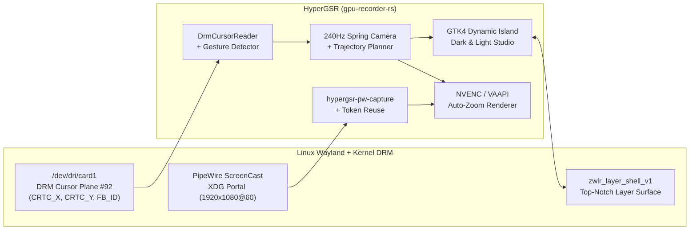

<div align="center">


<br/>

[](https://github.com/KunalSiyag/gpu-recorder-rs/stargazers)
[](https://github.com/KunalSiyag/gpu-recorder-rs/network/members)
[](https://github.com/KunalSiyag/gpu-recorder-rs/releases)
[](https://www.rust-lang.org/)
[](https://wayland.freedesktop.org/)
[](LICENSE)

<p align="center">
  <a href="#-15-second-quick-start"><b>⚡ 15-Second Install</b></a> •
  <a href="#-live-auto-zoom--dynamic-island-tour"><b>🎬 Live Demo</b></a> •
  <a href="#-custom-zoom-combinations--manual-camera-lock"><b>🎮 Custom Zoom Combos</b></a> •
  <a href="#-how-rootless-wayland-auto-zoom-works"><b>🔬 Under the Hood</b></a> •
  <a href="#-fork--hack-in-5-minutes"><b>🍴 Fork &amp; Extend</b></a> •
  <a href="RE_ANALYSIS.md"><b>🕵️ Decompilation Report</b></a>
</p>

> **If you've ever wished macOS [Screen Studio](https://screen.studio) existed natively on Linux Wayland without Electron bloat — give HyperGSR a ⭐ Star and [🍴 Fork](https://github.com/KunalSiyag/gpu-recorder-rs/fork) it!**

</div>

---

## ⚡ Why HyperGSR?

Linux has great raw encoders (`gpu-screen-recorder`, `OBS`, `wf-recorder`), but none of them give you **Screen Studio-style cinematic cursor auto-zoom**, **customizable zoom gesture combos**, and a **non-intrusive Dynamic Island HUD** that works natively on **Wayland** (`COSMIC`, `GNOME`, `KDE Plasma`, `Hyprland`, `Sway`).

Even worse: traditional Linux recorders try to track the mouse using `XQueryPointer` (`X11`), which **freezes or goes blind on native Wayland windows**.

**HyperGSR (`gpu-recorder-rs`) solves all of this in `~56 MB` of native Rust + C:**

- 🎯 **Rootless Wayland Global Cursor Tracking (`DRM Plane #92`)**: Reads hardware cursor plane coordinates (`CRTC_X`, `CRTC_Y`) and cursor shape changes (`FB_ID`) directly from `/dev/dri/card*` via `libdrm` at 60 Hz — **zero root privileges, zero XWayland freezes**.
- 🎥 **240 Hz Critically-Damped Spring Auto-Zoom**: Smooth $C^2$ continuous virtual camera (`zoom_engine.rs`) with bounded Screen Studio trajectory planning, dwell hysteresis, and fast-pan pull-back so the camera **never gets stuck zoomed in**.
- 🎮 **Self-Registering Custom Zoom Combos (`🎯 Record Combo…`)**: Trigger or lock zoom on demand using **Cursor Shake**, **Double-Click**, **Middle/Right Click**, **Mouse Side Buttons (`Mouse4`/`Mouse5`)**, **`Ctrl+Alt`**, **`Ctrl+Shift`**, **`Super+Z`**, or **Scroll Wheel** (`1.0×`–`3.2×`).
- 🏝️ **Native Wayland Layer-Shell Dynamic Island (`zwlr_layer_shell_v1`)**: Docks cleanly at the top center of your screen with true 32-bit RGBA rounded corners, live cursor/zoom telemetry, and 1-click **Obsidian Dark (`🌙`)** & **Pearl Light (`☀️`)** themes.
- 🚀 **100% Standalone PipeWire + XDG Desktop Portal + NVENC/VAAPI Capture**: Includes a standalone native PipeWire/Portal capture engine (`bin/hypergsr-pw-capture`) with persistent `restore_token` reuse (no repetitive permission popups) plus our reverse-engineered host-bridge fix for `gpu-screen-recorder` (`RE_ANALYSIS.md`).

<div align="center">
  
</div>

---

## 🎬 Live Auto-Zoom & Dynamic Island Tour

### 1. 60 FPS Spring-Physics Auto-Zoom & Cursor Ripple Showcase
Watch the virtual camera automatically glide into active code, terminal metrics, and timeline controls with critically-damped spring physics ($\zeta = 1.0$) and return smoothly to `1.0×` wide view during cross-screen travel:

<div align="center">
  
</div>

### 2. Compact Top-Notch Dynamic Island Bar
Stays out of your way while coding or presenting (`620×42 px`), showing real-time DRM cursor coordinates, active zoom multiplier (`1.0× Wide` / `2.0× Auto` / `🔒 Lock`), recording timer, and 1-click Studio toggle:

<div align="center">
  
</div>

### 3. Expanded Bento Studio — Obsidian Dark (`🌙`) & Pearl Light (`☀️`)
Click **`Studio ▾`** to open the live **16:9 Virtual Camera Radar**, **Spring S-Curve Telemetry**, **Custom Zoom Combo Recorder**, and **Camera Physics Presets**:

| Obsidian Dark Mode (`🌙`) | Pearl Frosted Light Mode (`☀️`) |
| :---: | :---: |
|  |  |

---

## 🎮 Custom Zoom Combinations & Manual Camera Lock

Want full manual control over when and how deep the camera zooms during a live tutorial or product demo? HyperGSR gives you both **AI-like Smart Auto-Zoom** and **100% Manual Combo Control**:

| Feature | How It Works |
| :--- | :--- |
| **🎯 Self-Registering Combo (`Record Combo…`)** | Click **`🎯 Record Combo…`** in the Studio drawer (or press any key/mouse button/shake gesture within 5 seconds) to bind your own custom zoom trigger on the fly. |
| **Built-In Gesture Presets** | `Shake / MidClick` • `Double-Click` • `Right-Click` • `Ctrl + Alt` • `Ctrl + Shift` • `Super + Z` • `Mouse4 / Mouse5` |
| **3 Combo Action Modes** | **1. `Toggle Lock`** (press once to lock zoom in, press again to return to `1.0×`)<br/>**2. `Hold Combo`** (stays zoomed while held, releases smoothly on let-go)<br/>**3. `Cycle 1×/2×/2.8×`** (steps through magnification depths on each trigger) |
| **🖱️ Live Scroll Wheel Zoom (`1.0×` – `3.2×`)** | Scroll the mouse wheel over the **16:9 Viewfinder Radar** (or use the `🔒 Lock / Unlock Zoom` button) to dial in exact magnification depth in real time. |

---

## 📊 Feature Comparison Matrix

| Capability | `gpu-screen-recorder` (v6.1.4) | OBS Studio | Screen Studio (macOS) | **HyperGSR (`gpu-recorder-rs`)** |
| :--- | :---: | :---: | :---: | :---: |
| **Native Linux Wayland & X11 Support** | ✅ (Broken on `--user` Flatpak) | ✅ Yes | ❌ macOS only | ✅ **Standalone Native + Flatpak Fix** |
| **Rootless Wayland Global Cursor Tracking** | ❌ X11 `XFixes` only | ❌ Compositor-dependent | ❌ macOS only | ✅ **DRM Hardware Cursor Plane `#92`** |
| **Automatic Spring-Physics Zoom-Ins** | ❌ None | ❌ Manual plugins | ✅ Yes | ✅ **240 Hz Critically-Damped Solver** |
| **Self-Registering Custom Zoom Combos** | ❌ None | ❌ Basic hotkeys | ⚠️ Limited | ✅ **Keys + Mouse Buttons + Shake + Wheel** |
| **Wayland Layer-Shell Dynamic Island HUD** | ❌ Legacy window | ❌ Full window | ❌ macOS menu bar | ✅ **`zwlr_layer_shell_v1` RGBA Island** |
| **Obsidian Dark & Pearl Light Themes** | ❌ None | ✅ Themes | ❌ Dark only | ✅ **1-Click Live CSS Theme Switching** |
| **Idle Memory & CPU Overhead** | ~45 MB | ~340 MB | ~650 MB (Electron) | **~56 MB RSS / `<1.5%` CPU (Native Rust)** |

---

## 🔬 How Rootless Wayland Auto-Zoom Works

We began by disassembling `com.dec05eba.gpu_screen_recorder` (`v6.1.4`) to understand why cursor tracking and user-installed Flatpak bridges fail on modern Wayland compositors. Full ELF disassembly notes are documented in [`RE_ANALYSIS.md`](RE_ANALYSIS.md).



1. **Direct DRM Hardware Cursor Plane Polling (`src/cursor.rs`)**:
   Instead of calling `XQueryPointer` (which deadlocks or stalls on rootless `Xwayland` when native Wayland windows have focus), `DrmCursorReader` opens `/dev/dri/card*`, enables `DRM_CLIENT_CAP_UNIVERSAL_PLANES` + `DRM_CLIENT_CAP_ATOMIC`, and reads `CRTC_X`, `CRTC_Y`, and `FB_ID` from the hardware cursor plane at 60 Hz without `sudo`.
2. **Critically-Damped 2D Spring-Damper Virtual Camera (`src/zoom_engine.rs`)**:
   The camera position $\mathbf{x}(t) = (c_x, c_y, z)$ is integrated at 240 Hz sub-steps using an exact critically-damped ODE ($\zeta = 1.0$, zero overshoot oscillation):

$$\ddot{\mathbf{x}} = -k(\mathbf{x} - \mathbf{x}_{\text{target}}) - 2\sqrt{k}\,\dot{\mathbf{x}}$$

3. **Two-Pass Trajectory Planner (`build_camera_trajectory` in `src/zoom_engine.rs`)**:
   During MP4 post-processing (`src/encoder.rs`), recorded cursor telemetry is analyzed to construct clean, bounded Screen Studio zoom segments (`hold_duration_ms`, fast-travel pull-back to `1.0×`, and smooth $C^2$ transitions) encoded with hardware `h264_nvenc` / `h264_vaapi`.

---

## 🚀 15-Second Quick Start

### 1. One-Command Install (Ubuntu / Pop!_OS / COSMIC / Debian / Fedora / Arch)

```bash
git clone https://github.com/KunalSiyag/gpu-recorder-rs.git
cd gpu-recorder-rs
./install.sh
```

Or install dependencies manually and build with Cargo:

<details>
<summary><b>📦 Manual Dependencies by Distro (Ubuntu/Debian, Fedora, Arch)</b></summary>

**Ubuntu / Pop!_OS / COSMIC / Debian:**
```bash
sudo apt update && sudo apt install -y \
  build-essential pkg-config cargo rustc clang \
  libgtk-4-dev libgtk4-layer-shell-dev libdrm-dev libx11-dev \
  libpipewire-0.3-dev libportal-dev ffmpeg
```

**Fedora:**
```bash
sudo dnf install -y \
  cargo rust gtk4-devel gtk4-layer-shell-devel libdrm-devel \
  libX11-devel pipewire-devel libportal-devel ffmpeg
```

**Arch Linux:**
```bash
sudo pacman -S --needed \
  rust gtk4 gtk4-layer-shell libdrm libx11 pipewire libportal ffmpeg
```
</details>

### 2. Run the Dynamic Island Studio

```bash
cargo build --release
./target/release/gpu-recorder-rs
```

### 3. CLI & Automation Modes

```bash
# Launch in Pearl Light Mode with the Studio drawer expanded:
HYPERGSR_THEME=light HYPERGSR_EXPANDED=1 ./target/release/gpu-recorder-rs

# Record a standalone 5-second Zero-Copy GPU + Auto-Zoom MP4 from the CLI:
./target/release/gpu-recorder-rs --record-seconds 5

# Export a self-contained 60 FPS GPU Auto-Zoom & Cursor FX showcase MP4:
./target/release/gpu-recorder-rs --export-demo ./hypergsr_demo.mp4

# Inspect GPU encoders, DRM cursor planes, and binary topology as JSON:
./target/release/gpu-recorder-rs --report

# Run the unit test suite:
cargo test
```

---

## 🍴 Fork & Hack in 5 Minutes

HyperGSR is intentionally architected as a clean, modular Rust workspace so you can **fork it** and build your own Linux screen-recording superpowers. Check out [`CONTRIBUTING.md`](CONTRIBUTING.md) for full details!

| What You Want to Hack | File to Edit | Difficulty |
| :--- | :--- | :---: |
| 🎨 **Add a new Dynamic Island Theme** (Catppuccin, Nord, Gruvbox, TokyoNight) | [`src/gui.rs`](src/gui.rs) (`build_css()`) | 🟢 Easy |
| 🎥 **Add a new Camera Spring Preset** (Bouncy, Cinematic Slow-Mo, Instant Snap) | [`src/zoom_engine.rs`](src/zoom_engine.rs) | 🟢 Easy |
| 🎮 **Add a new Global Gesture Trigger** (3-Finger Swipe, Circle Cursor, HotCorner) | [`src/cursor.rs`](src/cursor.rs) (`ZoomComboBinding`) | 🟡 Medium |
| ✨ **Add Custom GLSL Shaders** (Keystroke HUD, Spotlight Vignette, Chroma Key) | [`src/shaders.rs`](src/shaders.rs) & [`src/encoder.rs`](src/encoder.rs) | 🟡 Medium |
| 🔌 **Add Multi-Monitor / Audio Waveform Overlay** | [`src/pw_portal_capture.c`](src/pw_portal_capture.c) | 🔴 Advanced |

👉 **[Click here to Fork `gpu-recorder-rs`](https://github.com/KunalSiyag/gpu-recorder-rs/fork)** and open a Pull Request — we merge clean community PRs fast!

---

## 🗺️ Roadmap & Open Community Features

- [x] Native Wayland DRM Hardware Cursor Plane `#92` reader (`zero-root`)
- [x] Native Wayland Layer-Shell (`zwlr_layer_shell_v1`) Dynamic Island UI with Dark & Light modes
- [x] 240 Hz Critically-Damped Spring Camera & Bounded Trajectory Planner
- [x] Self-Registering Custom Zoom Combinations (`🎯 Record Combo…`) & Wheel Zoom
- [x] Standalone Native PipeWire + XDG Desktop Portal + NVENC/VAAPI Capture Engine
- [ ] Live On-Screen Keystroke Visualizer Pill (`Ctrl + C`, `Super + Enter`)
- [ ] Circular Webcam Picture-in-Picture (PiP) Overlay with Spring Follow
- [ ] Custom Desktop Background Padding & Shadow Frame (macOS Screen Studio Wallpaper Frame)
- [ ] Export directly to WebM / AV1 (`av1_nvenc` / `av1_vaapi`) & GIF

---

## 🌟 Support the Project

If **HyperGSR** saves you time or inspires your Linux desktop setup:
1. **⭐ Star this repository** at the top right of the page — it helps more Linux & Rust developers discover the project!
2. **🍴 Fork the repo** to customize your own themes, shaders, or zoom bindings.
3. **📣 Share it** on `r/rust`, `r/linux`, `r/unixporn`, Hacker News, or X!

## 📜 License

Released under the [MIT License](LICENSE). Built with ❤️ in Rust.
