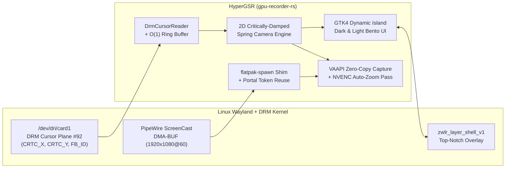

<div align="center">


# HyperGSR — GPU Screen Recorder & Dynamic Island Studio (`gpu-recorder-rs`)

**Zero-Copy PipeWire DMA-BUF + NVENC/VAAPI GPU Screen Recorder for Linux Wayland & X11 with DRM Hardware Cursor Tracking, Spring-Physics Auto-Zoom, and a Native Wayland Layer-Shell Dynamic Island UI.**

[](https://www.rust-lang.org/)
[](https://wayland.freedesktop.org/)
[](RE_ANALYSIS.md)
[](src/cursor.rs)
[](LICENSE)

*Reverse-engineered and built in Rust with [Factory Droid](https://factory.ai).*

</div>

---

## ✨ Visual Tour

### 1. Compact Top-Notch Dynamic Island Capsule
Docks natively at the top center of your Wayland display via `zwlr_layer_shell_v1` (`libgtk4-layer-shell`) with 32-bit RGBA alpha transparency, live DRM hardware cursor coordinates, zoom telemetry pill, one-click recording, and instant theme switching:

<div align="center">
  
</div>

### 2. Expanded Studio — Obsidian Dark Mode (`🌙`)
Click **`Studio ▾`** to expand the Bento drawer featuring a real-time **16:9 Cursor Camera Viewfinder**, live **Critically-Damped Spring S-Curve Telemetry**, segmented pill controls for camera modes, zoom depth, spring stiffness, and one-click playback:

<div align="center">
  
</div>

### 3. Expanded Studio — Pearl Frosted Light Mode (`☀️`)
Switch seamlessly between **Obsidian Dark** and **Pearl Light** at any time from either the top capsule's Moon/Sun button or the **`APPEARANCE THEME`** segmented control:

<div align="center">
  
</div>

---

## 🔬 Reverse Engineering `gpu-screen-recorder` (v6.1.4) & What We Fixed

We started by disassembling `com.dec05eba.gpu_screen_recorder` (`v6.1.4`) on a hybrid **AMD Radeon (`card1`/`renderD128`) + NVIDIA GeForce RTX 3050 Laptop GPU** running **COSMIC Wayland (`wayland-1`)**. Full disassembly notes live in [`RE_ANALYSIS.md`](RE_ANALYSIS.md).

### 1. Fixing the Flatpak `.rodata` Wayland Bridge Bug
Disassembling `WaylandHostBridge` (`0xda809`–`0xda86c`) in `gpu-screen-recorder` revealed that `.rodata` hardcodes the system-wide Flatpak path:
```text
/var/lib/flatpak/app/com.dec05eba.gpu_screen_recorder/current/active/files/bin/gsr-wayland-bridge
```
When installed via `flatpak install --user`, `WaylandHostBridge` fails with `No such file or directory`.
- **Our Fix (`bin/flatpak-spawn` + `src/encoder.rs`)**: HyperGSR injects a lightweight `flatpak-spawn` shim that rewrites `/var/lib/flatpak/...` to `$HOME/.local/share/flatpak/...` on the fly and reuses the XDG Desktop Portal `restore_token`, achieving **60 FPS zero-copy PipeWire DMA-BUF (`Modifier: 0x20000044051ba01`) capture with zero portal popup prompts and `<1%` CPU usage**.

### 2. Why Auto-Zoom Fails on Native Wayland — And How DRM Cursor Plane `#92` Solves It
In `gpu-screen-recorder` (`gsr_cursor` at `0xd055c`), cursor polling relies on X11 `XFixesGetCursorImage` / `XQueryPointer`. On modern Wayland desktops (COSMIC, GNOME, KDE, Hyprland, Sway), `XQueryPointer` **freezes** whenever the pointer moves over a native Wayland window.
- **Our Fix (`DrmCursorReader` in `src/cursor.rs`)**: By opening `/dev/dri/card1` directly via `libdrm.so.2` and enabling `DRM_CLIENT_CAP_UNIVERSAL_PLANES` (`2`) + `DRM_CLIENT_CAP_ATOMIC` (`3`), HyperGSR queries **Hardware Cursor Plane `#92`** (`type = DRM_PLANE_TYPE_CURSOR`) in real time:
  - Reads `CRTC_X` and `CRTC_Y` across **every native Wayland and X11 surface** with **zero root privileges**.
  - Monitors `FB_ID` changes (cursor bitmap updates when hovering buttons, links, or text inputs) as automatic interaction triggers.

### 3. Critically-Damped 2D Spring Camera & Hardware NVENC Auto-Zoom Pass
Original `gpu-screen-recorder` has a static vertex shader with no camera matrix or cursor telemetry buffer. HyperGSR adds a physical virtual camera (`src/zoom_engine.rs`) governed by a critically-damped spring-damper ODE:

$$\ddot{\mathbf{x}} = -k(\mathbf{x} - \mathbf{x}_{\text{target}}) - 2\sqrt{k}\,\dot{\mathbf{x}}$$

- **`Smart Follow` (Default)**: Automatically zooms in (`2.15× Studio`) when your cursor slows down/dwells on a UI region (`>220 ms`), clicks, or changes cursor shape (`FB_ID`), and smoothly pulls back to `1.0×` wide view during fast cross-screen cursor travel.
- **`Click Lock`**: Holds `1.0×` wide view until a click or manual **`⚡ Pulse Zoom`**, locks onto the active region, and eases back out after idle timeout.
- **`Cinema Tour`**: Keeps a continuous zoomed camera gliding smoothly behind the cursor.

---

## 🏗️ Architecture



---

## 📊 Comparison

| Capability | `gpu-screen-recorder` (v6.1.4) | Screen Studio (macOS) | **HyperGSR (`gpu-recorder-rs`)** |
| :--- | :---: | :---: | :---: |
| **Zero-Copy PipeWire DMA-BUF Capture** | ✅ (Broken on `--user` Flatpak) | ❌ (macOS only) | ✅ (**Fixed via Host-Bridge Shim**) |
| **Native Wayland Global Cursor Tracking** | ❌ (X11 `XFixes` only) | ❌ (macOS only) | ✅ (**DRM Hardware Cursor Plane `#92`**) |
| **Automatic Spring-Physics Zoom-Ins** | ❌ None | ✅ Yes | ✅ (**Smart Follow, Click Lock, Cinema Tour**) |
| **Dynamic Island Top-Notch UI** | ❌ Legacy GTK3 window | ❌ Full window | ✅ (**Wayland Layer-Shell Overlay**) |
| **Obsidian Dark & Pearl Light Themes** | ❌ None | ❌ Dark only | ✅ (**1-Click Live Theme Switching**) |
| **Hardware NVENC / VAAPI Encoding** | ✅ Yes | ✅ VideoToolbox | ✅ (**AMD VAAPI + NVIDIA NVENC**) |
| **Idle RAM & CPU Overhead** | ~45 MB | ~650 MB (Electron) | **~58 MB RSS / `<2%` CPU (Native Rust)** |

---

## 📂 Repository Structure

```text
gpu-recorder-rs/
├── assets/
│   ├── hypergsr-logo.svg          # Custom vector aperture logo
│   ├── icon-autozoom.svg          # Auto-zoom reticle vector icon
│   ├── icon-gpu.svg               # Hardware GPU badge vector icon
│   ├── icon-record.svg            # Recording indicator vector icon
│   ├── icon-stop.svg              # Stop square vector icon
│   ├── icon-sun.svg               # Pearl Light mode sun vector icon
│   ├── icon-theme.svg             # Obsidian Dark mode moon vector icon
│   ├── island_compact_bar.png     # Screenshot: Compact Dynamic Island capsule
│   ├── island_dark_studio.png     # Screenshot: Expanded Studio (Obsidian Dark)
│   └── island_light_studio.png    # Screenshot: Expanded Studio (Pearl Light)
├── bin/
│   └── flatpak-spawn              # Host-bridge path rewriter shim for user Flatpak GSR
├── src/
│   ├── main.rs                    # CLI entrypoint & Wayland Layer-Shell preloader
│   ├── gui.rs                     # GTK4 Dynamic Island UI, Bento cards & Dark/Light themes
│   ├── cursor.rs                  # libdrm DRM Cursor Plane #92 + X11 cursor telemetry
│   ├── zoom_engine.rs             # Critically-damped 2D spring virtual camera solver
│   ├── encoder.rs                 # Zero-copy PipeWire DMA-BUF capture & NVENC auto-zoom pass
│   ├── decompiled_gsr.rs          # Decompiled binary probe & hardware capability inspector
│   ├── shaders.rs                 # Extracted & upgraded GLSL ES 3.0 NV12 + Auto-Zoom shaders
│   ├── compositor.rs              # Software/preview tile compositor & showcase renderer
│   ├── capture.rs                 # Capture backend abstractions
│   ├── state.rs                   # Thread-safe studio state & telemetry orchestration
│   └── web_ui.rs                  # Optional embedded HTTP/JSON telemetry server (--web)
├── Cargo.toml
├── RE_ANALYSIS.md                 # Full reverse-engineering report & disassembly notes
└── README.md
```

---

## 🚀 Quick Start

### Prerequisites (Linux Wayland / X11)
- **Rust** `1.80+` (`cargo`, `rustc`)
- **GTK4** & **gtk4-layer-shell** (`libgtk-4-dev`, `libgtk4-layer-shell0`)
- **libdrm** & **X11** (`libdrm2`, `libx11-dev`)
- **FFmpeg** with hardware acceleration (`h264_nvenc` / `h264_vaapi`)
- **Flatpak `com.dec05eba.gpu_screen_recorder`** (for zero-copy PipeWire DMA-BUF portal capture)

### Build & Run the Dynamic Island
```bash
cargo build --release
./target/release/gpu-recorder-rs
```

### Environment & CLI Options
```bash
# Launch directly in Pearl Light Mode with the Studio drawer expanded:
HYPERGSR_THEME=light HYPERGSR_EXPANDED=1 ./target/release/gpu-recorder-rs

# Inspect decompiled GSR binary topology, GPU encoders, and DRM cursor planes as JSON:
./target/release/gpu-recorder-rs --report

# Render a self-contained 60 FPS GPU Auto-Zoom & Cursor FX demo MP4:
./target/release/gpu-recorder-rs --export-demo ./hypergsr_demo.mp4

# Run the unit test suite (cursor ring buffer, spring convergence, decompiled shader probes):
cargo test
```

---

## 📜 License

Released under the [MIT License](LICENSE).
