<div align="center">


<br/>

[](https://github.com/KunalSiyag/gpu-recorder-rs/actions/workflows/ci.yml)
[](https://github.com/KunalSiyag/gpu-recorder-rs/releases/latest)
[](https://www.npmjs.com/package/hypergsr)
[](https://crates.io/crates/gpu-recorder-rs)
[](LICENSE)
[](https://www.rust-lang.org/)
[](https://github.com/KunalSiyag/gpu-recorder-rs/stargazers)

**[Website](https://kunalsiyag.github.io/gpu-recorder-rs/)** ·
**[Download v1.1.0](https://github.com/KunalSiyag/gpu-recorder-rs/releases/latest)** ·
**[Promo video (10 s, 1080p60)](https://kunalsiyag.github.io/gpu-recorder-rs/hypergsr-promo-1080p60.mp4)** ·
**[How it works](#how-it-works)** ·
**[Write-up on DEV](https://dev.to/kunalsiyag/cursor-following-auto-zoom-on-linux-wayland-reading-the-cursor-from-the-gpu-in-rust-4nij)** ·
**[Contributing](CONTRIBUTING.md)**

</div>

HyperGSR (`gpu-recorder-rs`) is a screen recorder for Linux, written in Rust. It reads the cursor straight from the GPU's hardware cursor plane, without root, and moves a critically damped spring camera to wherever you are working, the way [Screen Studio](https://screen.studio) does on macOS. Capture goes through PipeWire and the XDG desktop portal, and encoding runs on NVENC or VAAPI.

It runs on native Wayland (COSMIC, GNOME, KDE Plasma, Hyprland, Sway) and on X11.

<div align="center">
  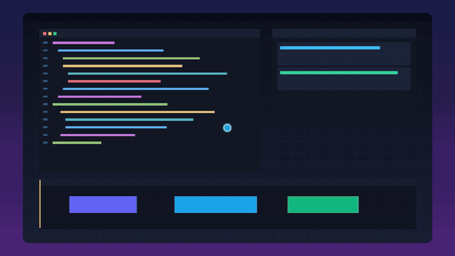
</div>

## Contents

- [What it does](#what-it-does)
- [Screenshots](#screenshots)
- [Measured footprint](#measured-footprint)
- [Install](#install)
- [Usage](#usage)
- [Zoom triggers](#zoom-triggers)
- [How it works](#how-it-works)
- [Compared with other recorders](#compared-with-other-recorders)
- [Project layout](#project-layout)
- [Roadmap](#roadmap)
- [Contributing](#contributing)

## What it does

- **Tracks the cursor on Wayland without root.** Recorders that call `XQueryPointer` go blind or stall once a native Wayland window has focus. HyperGSR opens `/dev/dri/card*` through `libdrm` and reads `CRTC_X`, `CRTC_Y` and `FB_ID` from the hardware cursor plane at 60 Hz.
- **Zooms like a camera operator.** A critically damped spring (ζ = 1.0) integrated at 240 Hz substeps moves the crop. Pause on something and the camera settles in; move fast and it pulls back to 1.0×, so it never gets stuck zoomed in.
- **Lets you take over.** Bind your own zoom trigger (keys, mouse buttons, shake, double-click), lock the zoom, or dial depth from 1.0× to 3.2× with the scroll wheel.
- **Stays out of the way.** The controls live in a small Dynamic Island docked to the top of the screen through `zwlr_layer_shell_v1`, with a dark and a light theme.
- **Asks for screen permission once.** The bundled PipeWire/portal helper (`bin/hypergsr-pw-capture`) stores the portal `restore_token`, so later recordings skip the picker.

## Screenshots

### Auto-zoom, before and after

| 1.0× wide, cursor travelling | 2.0× auto, cursor resting |
| :---: | :---: |
| 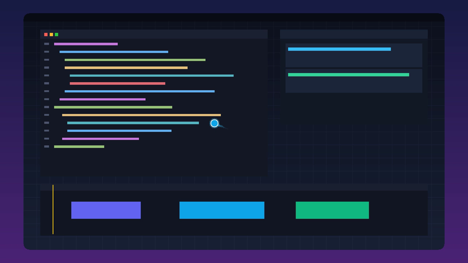 | 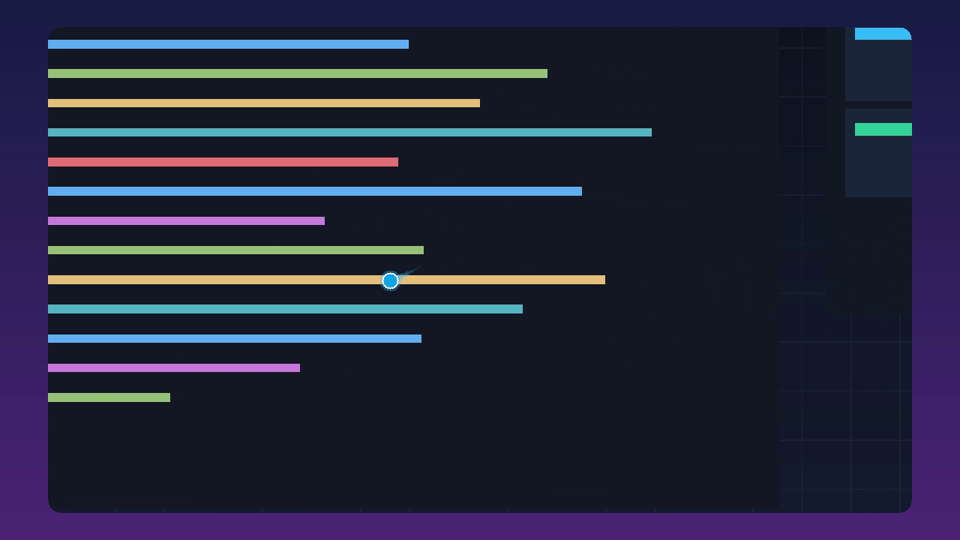 |

Both frames come from the same 60 FPS output of `--export-demo`.

### Dynamic Island

The compact bar shows the DRM cursor position, the current zoom (`1.0× Wide`, `2.0× Auto` or `Lock`), the recording timer and the Studio toggle.

<div align="center">
  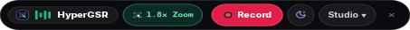
</div>

Click **Studio** to open the live cursor camera, zoom-combo recorder, zoom depth and spring presets.

| Dark | Light |
| :---: | :---: |
| 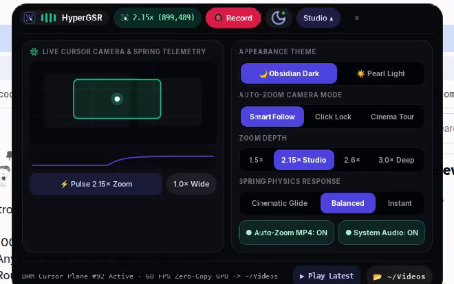 | 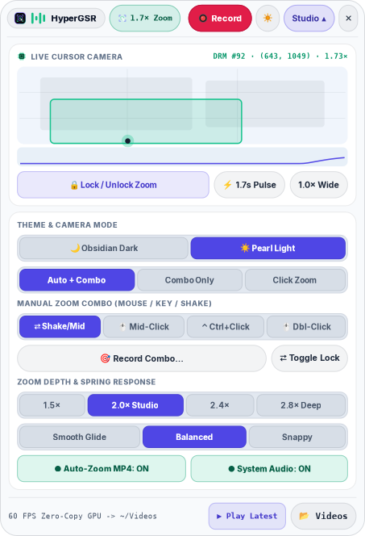 |

### Web Studio

`--web` serves a browser control panel on `http://127.0.0.1:7878` with the same camera, cursor effects, encoder choice and the `gpu-screen-recorder` inspector.

<div align="center">
  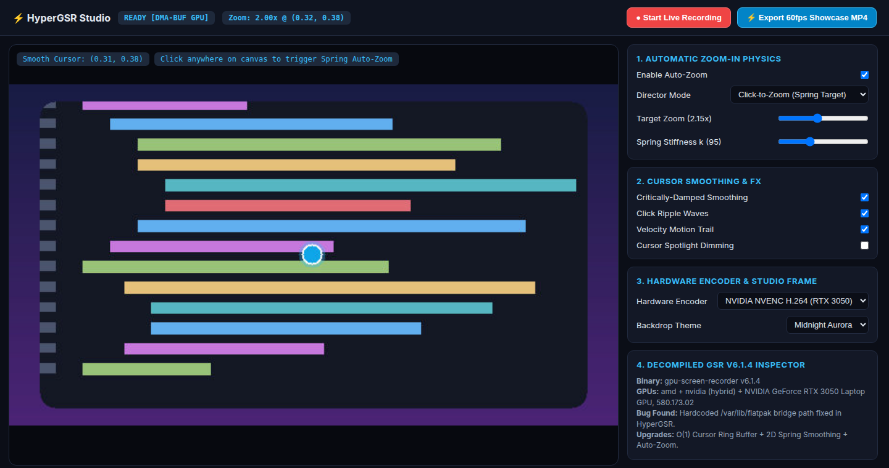
</div>

### Website and in-browser workbench

The [website](https://kunalsiyag.github.io/gpu-recorder-rs/) runs the same spring model in your browser, so you can try the camera before installing anything.

| Light | Dark |
| :---: | :---: |
| 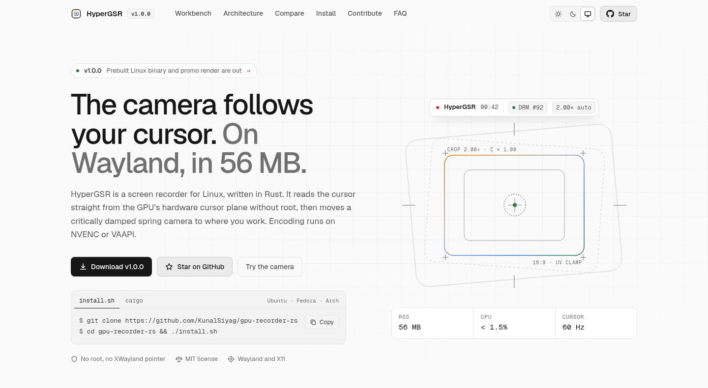 | 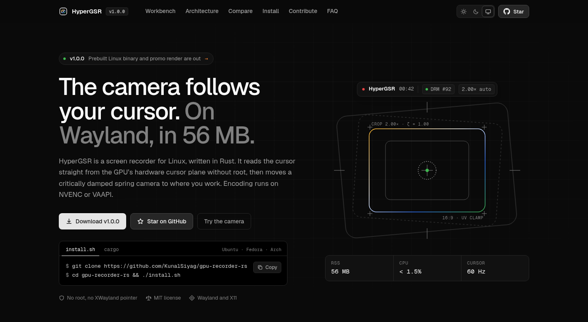 |

<div align="center">
  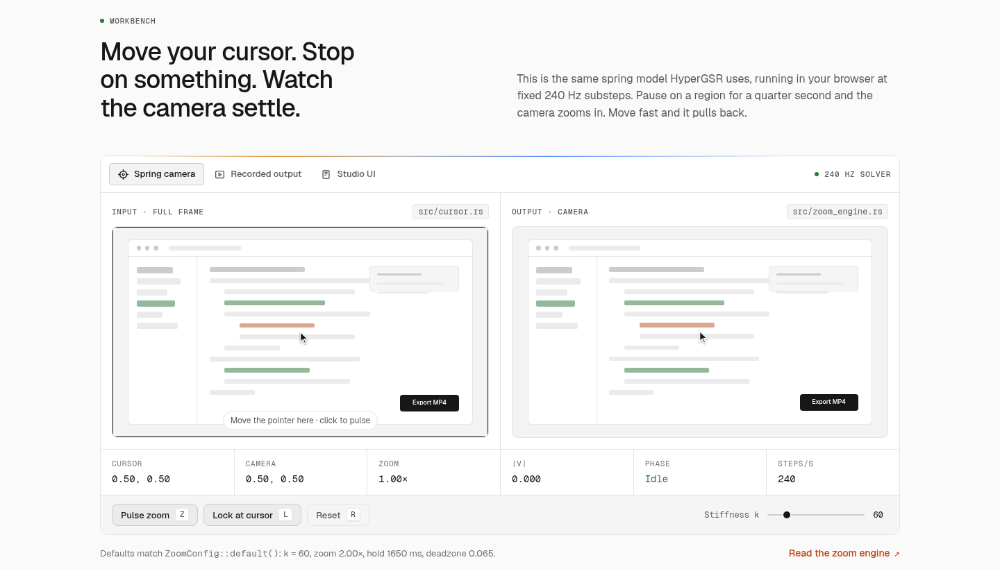
</div>

## Measured footprint

| Resident memory | CPU at 1080p60 | Cursor source | Camera solver |
| :---: | :---: | :---: | :---: |
| **56 MB** | **< 1.5 %** | DRM plane `#92` at 60 Hz | 240 Hz, ζ = 1.0 |

Measured during a 1080p60 recording on a hybrid AMD Radeon + NVIDIA RTX 3050 laptop under COSMIC, with NVENC preset P4. Your numbers will depend on GPU, compositor and resolution. Run `gpu-recorder-rs --report` to see the encoders and cursor planes it finds on your machine.

<div align="center">
  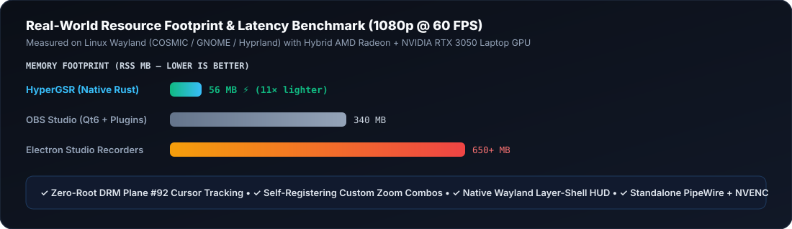
</div>

## Install

### npm / npx (Linux x86-64, glibc)

HyperGSR is published on npm as [`hypergsr`](https://www.npmjs.com/package/hypergsr):

```bash
npx hypergsr --report
npx hypergsr

# Or install the CLI globally
npm install -g hypergsr
hypergsr --web
```

The package bundles the native recorder, PipeWire capture helper, and UI icons.
It needs Node.js 22+ and a Linux x86-64 desktop with glibc. It does not support
macOS, Windows, ARM, or Alpine/musl. The bundled binaries need glibc 2.39 or newer
(Ubuntu 24.04+, Fedora 40+, or similar); older distributions should use the build
from source instructions below.

You still need **GTK 4.10+, gtk4-layer-shell, libdrm, X11 libraries, PipeWire,
libportal, FFmpeg, and an XDG desktop portal**. See the distro dependency instructions
below. npm does not install system packages, run `sudo`, compile Rust on the user's
machine, or download binaries from GitHub during installation.

All recorder arguments and environment variables are forwarded unchanged. Relative
paths such as `hypergsr --export-demo ./demo.mp4` resolve from your current directory.

To build and try the package locally, install the native build dependencies below, then:

```bash
npm test
npm pack
npm install -g ./hypergsr-1.1.0.tgz --ignore-scripts
hypergsr --report
```

`npm pack` builds both native binaries from source using the locked Cargo dependencies,
then checks the architecture, version, helper, and icons before creating the tarball.
Only the launcher and native runtime files are shipped, alongside the package metadata,
README, and license. `npm run build:native` builds the bundle without packing it.
Keep the npm and Cargo versions in sync. Maintainers should use the Ubuntu 24.04 CI
artifact for distribution rather than binaries built on a newer distro.

### Arch Linux

The repository includes tested PKGBUILDs. Build and install the prebuilt release with:

```bash
git clone https://github.com/KunalSiyag/gpu-recorder-rs.git
cd gpu-recorder-rs/packaging/aur/hypergsr-bin
makepkg -si
```

Use `packaging/aur/hypergsr-git` instead to build the latest `main` from source.

### Prebuilt binary (x86_64)

Download `hypergsr-v1.1.0-linux-x86_64.tar.gz` from the [latest release](https://github.com/KunalSiyag/gpu-recorder-rs/releases/latest), then:

```bash
tar xzf hypergsr-v1.1.0-linux-x86_64.tar.gz
./target/release/gpu-recorder-rs
```

You still need the runtime libraries listed below (GTK 4, gtk4-layer-shell, libdrm, PipeWire, libportal, FFmpeg).

### From source

```bash
git clone https://github.com/KunalSiyag/gpu-recorder-rs.git
cd gpu-recorder-rs
./install.sh
```

Or install the dependencies yourself and build with Cargo:

<details>
<summary><b>Dependencies by distro</b></summary>

**Ubuntu 25.10+ / Debian 13:**

```bash
sudo apt update && sudo apt install -y \
  build-essential pkg-config cargo rustc clang \
  libgtk-4-dev libgtk4-layer-shell-dev libdrm-dev libx11-dev \
  libpipewire-0.3-dev libportal-dev ffmpeg
```

**Ubuntu 24.04 / 25.04 / Pop!_OS 24.04:** `libgtk4-layer-shell-dev` isn't packaged before Ubuntu 25.10. `./install.sh` builds it from source automatically. To do it by hand, install everything above except that package, then:

```bash
sudo apt install -y meson ninja-build libwayland-dev libwayland-bin wayland-protocols
git clone --depth 1 --branch v1.3.0 https://github.com/wmww/gtk4-layer-shell.git
cd gtk4-layer-shell
meson setup build -Dexamples=false -Ddocs=false -Dtests=false -Dintrospection=false -Dvapi=false
ninja -C build && sudo ninja -C build install && sudo ldconfig
```

**Fedora:**

```bash
sudo dnf install -y \
  cargo rust gtk4-devel gtk4-layer-shell-devel libdrm-devel \
  libX11-devel pipewire-devel libportal-devel ffmpeg
```

**Arch Linux:**

```bash
sudo pacman -S --needed \
  rust gtk4 gtk4-layer-shell libdrm libx11 pipewire libportal ffmpeg
```

</details>

```bash
cargo build --release
./target/release/gpu-recorder-rs
```

With the same dependencies installed, you can also install it from crates.io:

```bash
cargo install gpu-recorder-rs
gpu-recorder-rs
```

The build compiles the PipeWire capture helper into the binary. On first use it is unpacked to
`~/.local/share/hypergsr/<version>/`, along with the UI icons.

## Usage

Running the binary with no arguments opens the Dynamic Island.

```bash
# Start in the light theme with the Studio drawer open
HYPERGSR_THEME=light HYPERGSR_EXPANDED=1 ./target/release/gpu-recorder-rs

# Record 5 seconds from the command line, with auto-zoom
./target/release/gpu-recorder-rs --record-seconds 5

# Render a self-contained 60 FPS auto-zoom showcase MP4
./target/release/gpu-recorder-rs --export-demo ./hypergsr_demo.mp4

# Print detected GPU encoders, DRM cursor planes and pipeline info as JSON
./target/release/gpu-recorder-rs --report

# Serve the Web Studio on http://127.0.0.1:7878
./target/release/gpu-recorder-rs --web

# Run the unit tests
cargo test
```

Recordings are saved to `~/Videos`.

## Zoom triggers

Auto-zoom handles most recordings. When you want control during a live tutorial or demo:

| Feature | How it works |
| :--- | :--- |
| **Record Combo…** | Click **Record Combo…** in the Studio drawer, then press any key, mouse button or shake gesture within 5 seconds to bind it as your zoom trigger. |
| **Built-in presets** | Shake / middle-click, double-click, right-click, `Ctrl+Alt`, `Ctrl+Shift`, `Super+Z`, `Mouse4` / `Mouse5` |
| **Action modes** | **Toggle lock**: press once to zoom in, again to return to 1.0×.<br/>**Hold**: stays zoomed while held and releases smoothly.<br/>**Cycle**: steps through 1×, 2× and 2.8×. |
| **Scroll-wheel zoom** | Scroll over the camera preview, or use **Lock / Unlock Zoom**, to set depth from 1.0× to 3.2×. |

## How it works

HyperGSR started as a reverse-engineering pass over `gpu-screen-recorder` 6.1.4, to find out why cursor tracking and user-installed Flatpak bridges fail on Wayland. What it kept, what it replaced and why is written up in [`RE_ANALYSIS.md`](RE_ANALYSIS.md). For the longer story behind the cursor plane trick and the spring camera, read [Cursor-following auto-zoom on Linux Wayland: reading the cursor from the GPU in Rust](https://dev.to/kunalsiyag/cursor-following-auto-zoom-on-linux-wayland-reading-the-cursor-from-the-gpu-in-rust-4nij) on DEV.

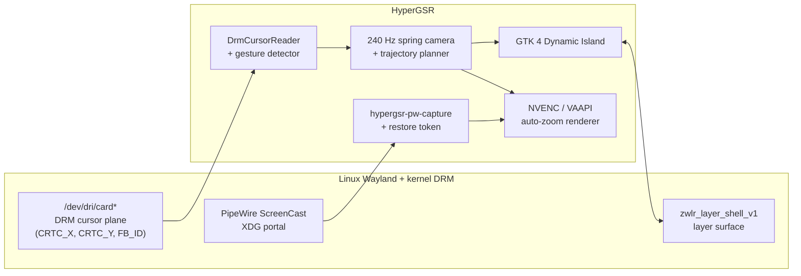

1. **Cursor from the GPU, not the compositor** ([`src/cursor.rs`](src/cursor.rs)). `DrmCursorReader` enables `DRM_CLIENT_CAP_UNIVERSAL_PLANES` and `DRM_CLIENT_CAP_ATOMIC`, finds the cursor plane and reads its position and framebuffer at 60 Hz. The plane already holds the exact position the display controller is drawing, so no compositor protocol is needed.
2. **A spring with exactly enough damping** ([`src/zoom_engine.rs`](src/zoom_engine.rs)). Pan and zoom are springs with damping set to 2√k, the critical point, integrated at 240 Hz substeps. The camera reaches its target as fast as it can without overshooting:

   $$\ddot{\mathbf{x}} = -k(\mathbf{x} - \mathbf{x}_{\text{target}}) - 2\sqrt{k}\,\dot{\mathbf{x}}$$

3. **Two-pass trajectory planning** (`build_smooth_60fps_camera_frames` in [`src/encoder.rs`](src/encoder.rs)). After recording, the cursor telemetry is turned into bounded zoom segments (about 1.75 s per focus cluster), with pull-back to 1.0× during fast travel and smooth transitions, then the final MP4 is encoded with `h264_nvenc` or `h264_vaapi`.

## Compared with other recorders

OBS and `gpu-screen-recorder` are excellent general-purpose recorders. HyperGSR does one thing they don't do out of the box: a camera that follows the cursor on Wayland.

| | `gpu-screen-recorder` 6.1.4 | OBS Studio | Screen Studio | **HyperGSR** |
| :--- | :---: | :---: | :---: | :---: |
| Runs on Linux Wayland | Yes (Flatpak `--user` bridge broken) | Yes | No, macOS only | **Yes** |
| Cursor tracking on native Wayland | X11 `XFixes` only | Depends on compositor | n/a | **DRM cursor plane** |
| Automatic zoom | No | Plugins, manual | Yes | **Yes, spring camera** |
| Custom zoom triggers | No | Basic hotkeys | Limited | **Keys, mouse buttons, shake, wheel** |
| Idle memory | ~45 MB | ~340 MB | ~650 MB (Electron) | **~56 MB** |

## Project layout

| Path | What's in it |
| :--- | :--- |
| [`src/main.rs`](src/main.rs) | CLI modes and startup (preloads gtk4-layer-shell on Wayland) |
| [`src/gui.rs`](src/gui.rs) | GTK 4 Dynamic Island, Studio drawer and themes (`load_dynamic_island_css()`) |
| [`src/cursor.rs`](src/cursor.rs) | DRM and X11 cursor readers, shake detection, click ripples |
| [`src/zoom_engine.rs`](src/zoom_engine.rs) | Spring camera, auto-zoom modes and zoom-combo bindings |
| [`src/encoder.rs`](src/encoder.rs) | Trajectory planner, auto-zoom rendering and NVENC/VAAPI encoding through FFmpeg |
| [`src/shaders.rs`](src/shaders.rs) | GLSL for cursor ripples and effects |
| [`src/pw_portal_capture.c`](src/pw_portal_capture.c) | Standalone PipeWire + XDG portal capture helper |
| [`src/web_ui.rs`](src/web_ui.rs) | Web Studio server (`--web`) |
| [`docs/`](docs/) | Website, served by GitHub Pages |

## Roadmap

- [x] Rootless DRM cursor plane reader
- [x] Layer-shell Dynamic Island with dark and light themes
- [x] 240 Hz spring camera and trajectory planner
- [x] Custom zoom combos and scroll-wheel zoom
- [x] Standalone PipeWire + portal + NVENC/VAAPI capture
- [ ] On-screen keystroke overlay (`Ctrl+C`, `Super+Enter`)
- [ ] Circular webcam picture-in-picture that follows the camera
- [ ] Wallpaper padding and shadow frame around the recording
- [ ] WebM / AV1 (`av1_nvenc`, `av1_vaapi`) and GIF export

## Contributing

Pull requests are welcome. [`CONTRIBUTING.md`](CONTRIBUTING.md) covers setup, and these are good places to start:

| Idea | Where | Difficulty |
| :--- | :--- | :---: |
| A new Island theme (Catppuccin, Nord, Gruvbox, Tokyo Night) | [`src/gui.rs`](src/gui.rs) `load_dynamic_island_css()` | Easy |
| A new camera preset (bouncy, slow cinematic, instant snap) | [`src/zoom_engine.rs`](src/zoom_engine.rs) | Easy |
| A new gesture trigger (circle cursor, hot corner) | [`src/zoom_engine.rs`](src/zoom_engine.rs) `ZoomComboBinding`, [`src/cursor.rs`](src/cursor.rs) | Medium |
| New shader effects (spotlight vignette, keystroke HUD) | [`src/shaders.rs`](src/shaders.rs), [`src/encoder.rs`](src/encoder.rs) | Medium |
| Multi-monitor capture or an audio waveform overlay | [`src/pw_portal_capture.c`](src/pw_portal_capture.c) | Advanced |

If HyperGSR is useful to you, a star helps other Linux and Rust developers find it.

## License

[MIT](LICENSE)
